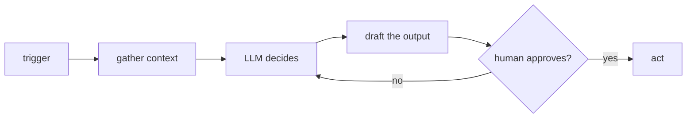

<div align="center">


<br/>


</div>

## hey, I'm Dikshit

Most people complete JEE and sleep for a week. I opened my laptop and started a company.

It didn't work out the way we hoped, and I learned a lot from it. The team carried on as Meritverse, a small software consultancy where we build web apps and AI agents for clients. I'm a first year at NITK Surathkal now, studying metallurgy and writing a lot more code than the degree asks for. I'll probably end up running my own thing someday, but there's no rush. I'm going with the flow and seeing where it takes me.

```
dikshit@opensuse
----------------
OS         openSUSE
Uptime     first year at NITK Surathkal
Langs      Rust (for fun), Python, TypeScript, Go, C++
Agents     LangGraph, MCP servers, RAG
Day job    Meritverse (software consultancy)
Sleep      loves it
```

## what I'm good at

I run openSUSE and I like knowing what's going on underneath. That's why I write Rust and C++ for fun, usually low-level things like graphics, encoding, compression and hashing, and I try to do it without AI help because that's half the enjoyment. I also tinker with ESP32 boards and do some competitive programming.

I'm a nerd about agentic AI. I build with LangGraph, MCP servers and RAG, and what I like most is getting an LLM to do a whole job, pause when a person needs to approve something, and pick up again after.

I build full stack apps with React, NextJS, NodeJS, edge functions and React Native. On the backend side I'm comfortable with Docker, CI/CD, Google Cloud, Cloudflare, Postgres, MongoDB and Redis, and I like shipping things so they keep running after I close the laptop.

This is the rough shape most of my agents end up with:



## the toolbox


## scoreboard

<div align="center">


</div>

## find me

[dikshitrj.in](https://dikshitrj.in) · [LinkedIn](https://linkedin.com/in/dikshitrj)

If I don't reply, I'm probably asleep.
